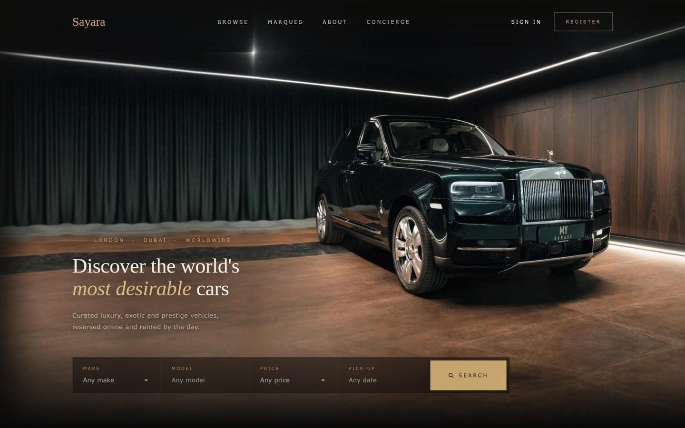
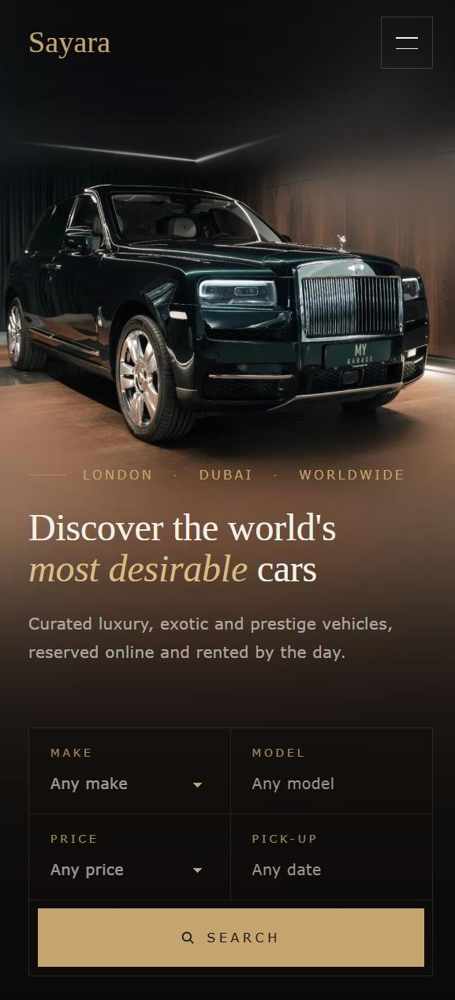
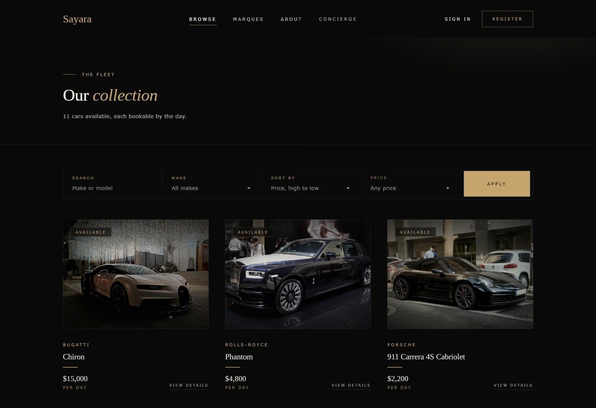
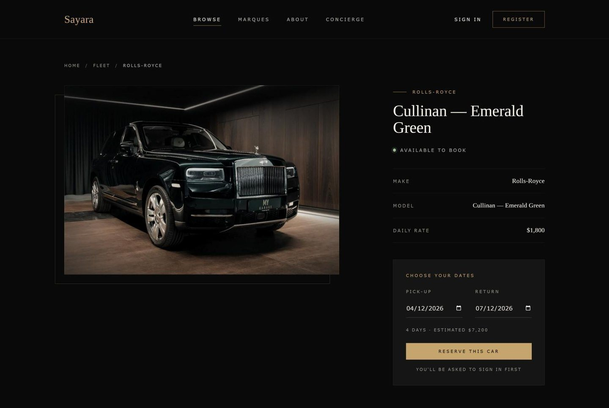
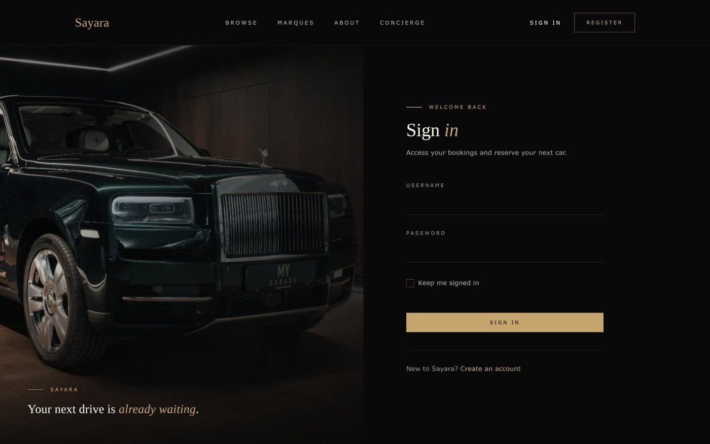
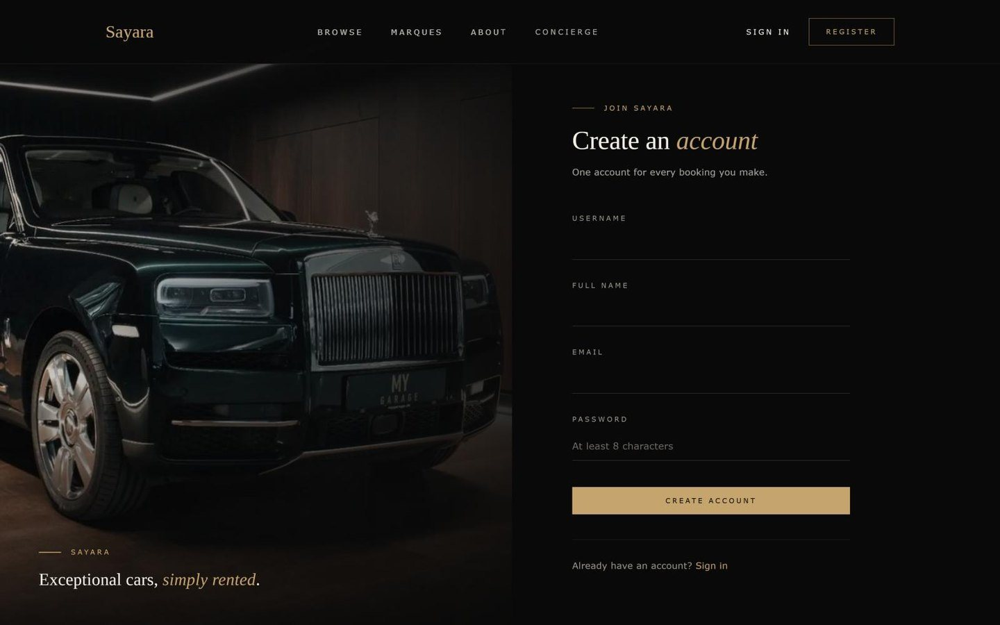
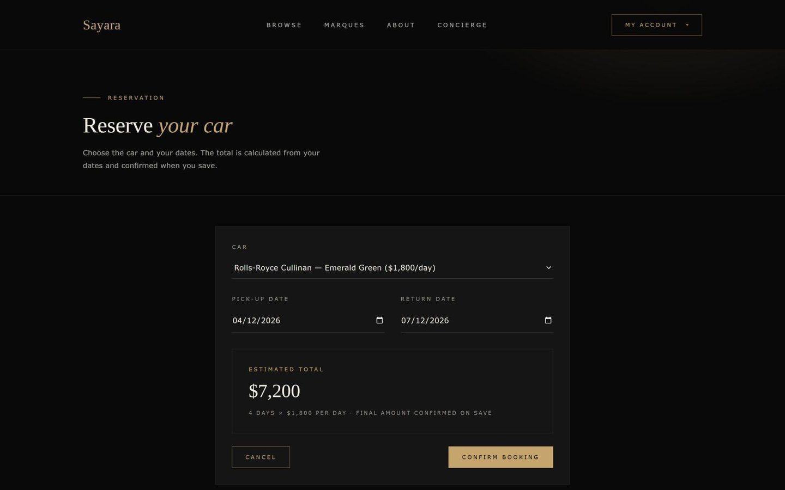
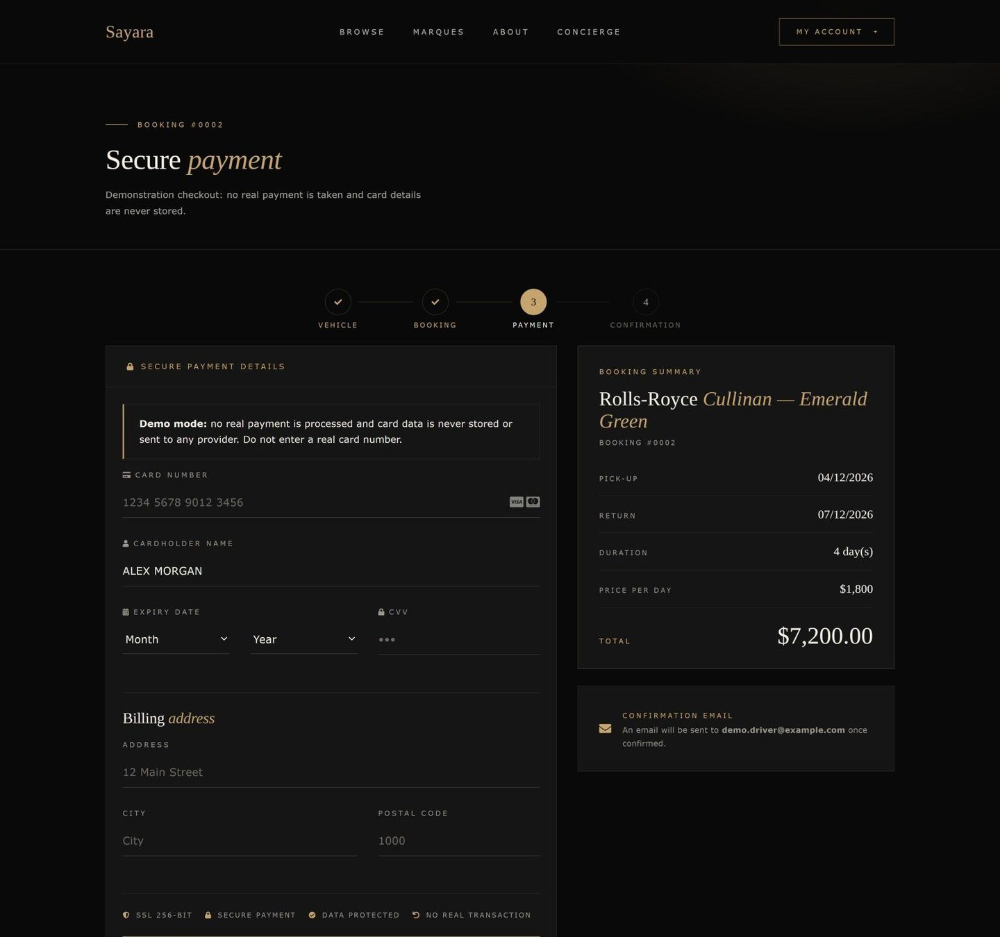

# Sayara — Luxury Car Rental Platform

Sayara is a full-stack car rental web application built with **Symfony 7.4** and **PHP 8.4**. Customers browse a curated fleet of luxury, exotic and prestige vehicles, compare daily rates, reserve a car for specific dates and complete a demonstration checkout. Administrators manage the fleet, customers and bookings from a dedicated dashboard.

The project focuses on a polished, editorial interface backed by a conventional, well-tested Symfony architecture: Doctrine entities and migrations, form-based validation, role-based access control, CSRF protection, security headers and an automated test suite that runs in GitHub Actions.

<p align="center">
  
</p>

> **Demonstration project.** The checkout step is a simulation. No payment provider is connected, and card details are never stored or transmitted. Never enter a real card number.

---

## Contents

- [Features](#features)
- [Tech stack](#tech-stack)
- [Screenshots](#screenshots)
- [Getting started](#getting-started)
- [Environment configuration](#environment-configuration)
- [Database setup](#database-setup)
- [Running the tests](#running-the-tests)
- [Security](#security)
- [Continuous integration](#continuous-integration)
- [Project structure](#project-structure)
- [Production deployment](#production-deployment)
- [Author](#author)

---

## Features

### For customers

- **Homepage search** — search the fleet by make, model, maximum daily price and pick-up date directly from the hero section.
- **Vehicle catalogue** — available cars only, with free-text search, make filter, maximum daily price and sorting by price or name.
- **Vehicle details** — specifications, daily rate and a date picker that shows the number of days and an estimated total before booking.
- **Accounts** — registration, sign-in with an optional "keep me signed in" cookie, sign-out, and a profile page with booking history and profile editing.
- **Reservations** — create, edit and cancel your own bookings. The total is calculated from the rental dates and the car's availability is updated automatically.
- **Checkout** — a demonstration payment step with a booking summary, a confirmation page and an HTML confirmation email.
- **Informational pages** — About, Contact and a photo credits page for licensed imagery.

### For administrators

- **Dashboard** — fleet and booking statistics with charts (Chart.js).
- **Fleet management** — create, edit and delete cars, including validated image uploads.
- **Customer and reservation management** — manage user accounts and create or edit bookings on behalf of a customer.
- **Admin provisioning** — `php bin/console app:create-admin` creates an administrator with a securely prompted password.

### For developers

- **Preview environment** — `app:preview:seed` fills a separate `var/preview.db` with a demo fleet for local design and screenshot work. It refuses to run against any other database.
- **Automated quality checks** — PHPUnit, Twig/YAML/container linting and a Composer security audit run on every pull request to `main`.

---

## Tech stack

| Layer | Technologies |
|---|---|
| Backend | PHP 8.4, Symfony 7.4 (Security, Form, Validator, Mailer, Rate Limiter, Console) |
| Persistence | Doctrine ORM 3, Doctrine Migrations, SQLite (MySQL supported through `DATABASE_URL`) |
| Front end | Twig, Symfony AssetMapper, CSS, JavaScript, Bootstrap 4, Chart.js (admin dashboard) |
| Testing | PHPUnit 12 with an isolated SQLite test database |
| CI | GitHub Actions |

---

## Screenshots

All screenshots were captured from the running application using the local preview database and a fictional demo account.

<table>
  <tr>
    <td width="72%"></td>
    <td width="28%"></td>
  </tr>
  <tr>
    <td align="center"><sub>Homepage — desktop</sub></td>
    <td align="center"><sub>Homepage — mobile</sub></td>
  </tr>
</table>

### Vehicle catalogue



### Vehicle details



### Sign-in and registration

<table>
  <tr>
    <td width="50%"></td>
    <td width="50%"></td>
  </tr>
</table>

### Booking and checkout

<table>
  <tr>
    <td width="50%"></td>
    <td width="50%"></td>
  </tr>
</table>

---

## Getting started

### Requirements

- PHP **8.4** with the `pdo_sqlite`, `intl`, `mbstring`, `fileinfo` and `openssl` extensions
- [Composer](https://getcomposer.org/)
- Optional: the [Symfony CLI](https://symfony.com/download) and a local mail catcher such as [Mailpit](https://mailpit.axllent.org/)

> The locked dependencies require PHP 8.4. This is also the version tested in CI.

### Installation

```bash
git clone https://github.com/ranimedogaz1234-dot/Sayara.git
cd Sayara
composer install

# Base configuration (placeholders only). .env is git-ignored in this project.
cp .env.example .env

# Generate a secret and store it in .env.local, which is never committed
php -r 'echo "APP_SECRET=", bin2hex(random_bytes(32)), PHP_EOL;' > .env.local
```

Then set up the database (see [Database setup](#database-setup)) and start the server:

```bash
symfony server:start
# or, without the Symfony CLI:
php -S 127.0.0.1:8000 -t public
```

Open <http://127.0.0.1:8000>.

---

## Environment configuration

Configuration is read from environment variables. `.env.example` lists every variable the application needs, with placeholder values only. Real values belong in `.env.local`, in real environment variables or in [Symfony secrets](https://symfony.com/doc/current/configuration/secrets.html), and never in committed files.

| Variable | Purpose | Example (placeholder) |
|---|---|---|
| `APP_ENV` | Runtime environment | `dev`, or `prod` in production |
| `APP_SECRET` | Secret used for CSRF tokens, remember-me cookies and signing | a long random string |
| `APP_SHARE_DIR` | Shared cache directory | `var/share` |
| `DEFAULT_URI` | Base URL used when generating links outside a request | `http://localhost` |
| `DATABASE_URL` | Database connection | `sqlite:///%kernel.project_dir%/var/data.db` |
| `MESSENGER_TRANSPORT_DSN` | Messenger transport | `doctrine://default?auto_setup=0` |
| `MAILER_DSN` | SMTP server for confirmation emails | `smtp://localhost:1025` |

`.env`, `.env.local`, `.env.*.local`, `.env.test`, all `*.db` files and `var/` are listed in `.gitignore`.

---

## Database setup

The default database is a single SQLite file, `var/data.db`.

### Fresh installation

```bash
php bin/console doctrine:database:create --if-not-exists
php bin/console doctrine:migrations:migrate --no-interaction

# Create the first administrator (the password is prompted, minimum 8 characters)
php bin/console app:create-admin <username> <email>
```

The migrations create the schema and add a set of demo vehicles.

### Existing database

If you already have data in `var/data.db`, **do not drop or recreate it**. Back it up, check which migrations are pending, and apply only those:

```bash
cp var/data.db var/data.db.backup
php bin/console doctrine:migrations:status
php bin/console doctrine:migrations:migrate --no-interaction
```

### Optional preview database

To try the interface with a richer demo fleet without touching your own data, point a local configuration at a separate preview file and seed it:

```bash
# in .env.local
DATABASE_URL="sqlite:///%kernel.project_dir%/var/preview.db"
```

```bash
php bin/console app:preview:seed
```

The command reads `config/preview/fleet.json` and refuses to run unless the active connection is `var/preview.db`.

---

## Running the tests

The test suite runs against its own SQLite file under `var/` (`var/test.db`) and never against `var/data.db`. Every database-backed test checks the resolved database path before running, and stops if it is not an isolated `var/test*.db` file.

```bash
# One-time: test environment variables (git-ignored)
printf "KERNEL_CLASS='App\\\\Kernel'\nAPP_SECRET=%s\n" "$(php -r 'echo bin2hex(random_bytes(16));')" > .env.test

# One-time: create the schema in the isolated test database
php bin/console doctrine:schema:create --env=test --no-interaction

# Run the suite and the linters
php bin/phpunit
php bin/console lint:twig templates
php bin/console lint:yaml config
php bin/console lint:container
```

The suite covers authentication and sessions, CSRF protection, role-based access, IDOR prevention on reservations, unauthorised access, security headers, form validation, the profile controller and the homepage vehicle selection.

---

## Security

Security features implemented in the application:

- **Password hashing** with Symfony's `auto` hasher (bcrypt or Argon2, depending on the platform).
- **CSRF protection** on the login form, logout and every state-changing form, including delete actions.
- **Login throttling**: five failed attempts trigger a temporary lockout.
- **Role-based access control** (`ROLE_USER`, `ROLE_ADMIN`) through `access_control` rules and `#[IsGranted]` attributes. The dashboard, fleet and user management are admin-only.
- **Ownership checks** on reservations: customers can only view, edit or pay for their own bookings (IDOR prevention, covered by tests).
- **Security headers** on every response: Content-Security-Policy, `X-Content-Type-Options: nosniff`, `X-Frame-Options: DENY`, `Referrer-Policy` and `Permissions-Policy`, plus HSTS in production over HTTPS.
- **Validated uploads**: vehicle images are checked by real MIME type (JPEG, PNG, WebP, GIF) and size (5 MB), then stored under randomised file names.
- **No real payment data**: the checkout is a demonstration and does not store or forward card details.
- **Secret hygiene**: secrets live only in git-ignored local files or environment variables, and CI uses throwaway placeholder values.

Front-end libraries are loaded from public CDNs without Subresource Integrity. Self-hosting them or adding SRI hashes is recommended before a production deployment.

---

## Continuous integration

GitHub Actions ([`.github/workflows/ci.yml`](.github/workflows/ci.yml)) runs on every pull request targeting `main` and on every push to `main`. The job uses PHP 8.4 on Ubuntu and:

1. validates `composer.json` and `composer.lock`, then installs dependencies;
2. runs a PHP syntax check on `src/` and `tests/`;
3. lints YAML configuration, Twig templates and the service container;
4. creates the isolated test database schema and runs PHPUnit;
5. runs `composer audit` to check dependencies against known security advisories.

The workflow has read-only repository permissions and uses placeholder values only.

---

## Project structure

```
├── assets/                 Stylesheets and images served through AssetMapper
├── config/
│   ├── packages/           Bundle configuration (security, doctrine, mailer, ...)
│   └── preview/            Demo fleet definition and photos for the preview database
├── docs/screenshots/       Screenshots used in this README
├── migrations/             Doctrine migrations (schema and demo vehicles)
├── public/                 Web root (front controller, uploaded vehicle images)
├── src/
│   ├── Command/            app:create-admin, app:preview:seed
│   ├── Controller/         Home, Security, Reservation, Payment, Profile, Voiture, User, Dashboard
│   ├── Entity/             User, Voiture (vehicle), Reservation
│   ├── EventSubscriber/    Security headers
│   ├── Form/               Form types with validation rules
│   ├── Repository/         Doctrine repositories (search, availability, featured selection)
│   └── Twig/               Price formatting and photo-credit extensions
├── templates/              Twig templates (public site, account, booking, payment, admin)
├── tests/                  PHPUnit tests (security, controllers, forms, subscribers)
└── .github/workflows/      GitHub Actions CI
```

---

## Production deployment

`.env.example` is a development template. For a real deployment, use `.env.prod.example` as the reference and provide the values as real environment variables (or in a git-ignored `.env.prod.local`).

1. Set `APP_ENV=prod` and `APP_DEBUG=0`, which keeps the profiler and debug toolbar off.
2. Install dependencies without dev tooling: `composer install --no-dev --optimize-autoloader`.
3. Provide real values for `APP_SECRET`, `DATABASE_URL` and `MAILER_DSN`.
4. Warm the cache: `php bin/console cache:clear --env=prod --no-debug`.
5. Run pending migrations: `php bin/console doctrine:migrations:migrate --no-interaction --env=prod`.
6. Compile assets: `php bin/console asset-map:compile --env=prod`.

---

## Author

**Ranime Doggaz** — Full-stack developer

- GitHub: [@ranimedogaz1234-dot](https://github.com/ranimedogaz1234-dot)

Vehicle photographs belong to their respective owners. Licensed third-party images are credited on the application's `/credits` page.
